  

Hi 👋 I wander between fields and build open-source tools wherever a problem catches my interest.

### 🛠️ Tools

<picture>
  <source media="(prefers-color-scheme: dark)" srcset="https://skillicons.dev/icons?i=py%2Cc%2Cmatlab%2Canaconda%2Cqt%2Clinux%2Cubuntu%2Cbash%2Cgit%2Cgithub%2Cvscode&theme=dark">
  
</picture>

### 📈 Activity

  

  <picture>
    <source media="(prefers-color-scheme: dark)" srcset="https://github-readme-streak-stats.herokuapp.com/?user=Bio-Otto&theme=dark&hide_border=true">
    
  </picture>

### 📫 Reach me

### ☕ Support

If something I built saved you some time, you can buy me a coffee, or just leave a ⭐ on the repo.

  <picture>
    <source media="(prefers-color-scheme: dark)" srcset="./assets/quote-dark.svg">
    
  </picture>

<picture>
  <source media="(prefers-color-scheme: dark)" srcset="https://raw.githubusercontent.com/Bio-Otto/Bio-Otto/output/github-snake-dark.svg">
  
</picture>

